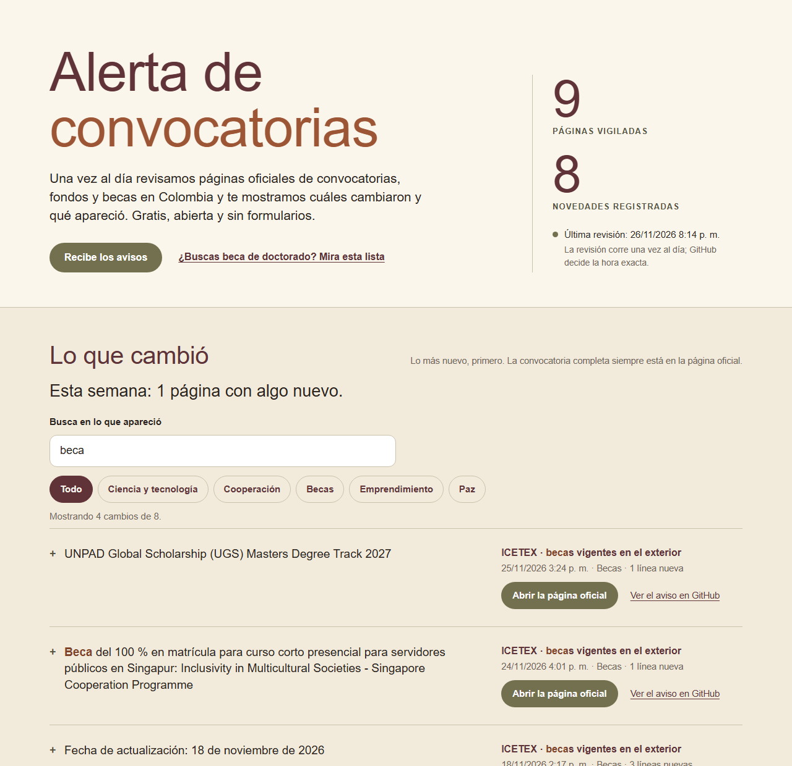

# Alerta de convocatorias · Colombia

[Español](#español) · [English](#english)

## Español

Una herramienta gratis y abierta que revisa una vez al día páginas oficiales de convocatorias, fondos y becas en Colombia, y avisa cuáles cambiaron y qué apareció. Es para equipos de cooperación, ONG, fundaciones, universidades y proyectos que no quieren abrir diez páginas cada semana.

**Ábrela aquí:** https://estado-x.github.io/alerta-convocatorias-colombia/

### Qué hace

- Revisa una vez al día las páginas de `fuentes.txt`: hoy, MinCiencias, MinTIC, APC-Colombia (fondos de cooperación y comisiones mixtas sur-sur), ICETEX (becas en el exterior), Fondo Acción, Fondo Emprender, el Fondo Multidonante de la ONU para la Paz y la Fundación Bolívar Davivienda.
- Muestra cuándo cambió cada página y qué líneas nuevas aparecieron, con lo nuevo primero.
- **Busca y filtra lo que apareció:** escribe «beca», «paz» o tu departamento, y filtra por tipo (Ciencia y tecnología, Cooperación, Becas, Emprendimiento y Paz). La búsqueda queda en la dirección, así que la puedes compartir: `?buscar=beca&tipo=Becas`.
- Tiene una lista aparte de **becas de doctorado**, en Colombia y en el exterior (`fuentes-doctorado.txt`; página https://estado-x.github.io/alerta-convocatorias-colombia/doctorado/): MinCiencias, ICETEX, Colfuturo, Fulbright Colombia y Fundación Carolina. Se filtra por «En Colombia» o «En el exterior». Se revisa con `python scripts/revisar.py --lista doctorado` y sus datos quedan en `data/doctorado/`.
- Avisa de tres formas, sin formularios: en la página y por RSS (`data/feed.xml`, más un RSS por tipo, como `data/feed-becas.xml`), sin cuentas, y con un aviso en GitHub que llega por correo a quien siga el repo (con una cuenta gratis de GitHub).
- **Solo avisa cuando aparece algo nuevo.** Si en una página solo desaparecieron líneas, queda anotado abajo como «sin novedades», sin aviso y fuera del RSS. Los avisos del robot llevan la etiqueta `aviso` (y `doctorado` los de esa lista) y se cierran solos a los 30 días; el cambio sigue en la página y en el RSS.

### Cómo funciona

1. Un flujo de GitHub Actions corre `scripts/revisar.py` una vez al día. Está programado a las 4:17 a. m. (hora de Colombia), en un minuto raro para que GitHub lo retrase menos, pero GitHub puede correrlo varias horas después cuando tiene mucha carga. La página siempre dice a qué hora fue la última revisión.
2. El script descarga cada página, saca el texto visible línea por línea y lo compara con el de la revisión anterior (`data/textos/`).
3. Si aparecieron líneas, lo anota en `data/cambios.json`, actualiza `data/estado.json` y los RSS, y abre un aviso (issue) en el repo. Si solo desaparecieron, lo anota como «sin novedades».
4. Si una página no responde, las demás siguen y esa conserva su última revisión. Cada corrida queda en `data/corrida.json`.

Solo usa la biblioteca estándar de Python: no hay servidor, base de datos ni claves.

### Cómo colaborar

La lista es de todos y colaborar es gratis. Con una cuenta de GitHub puedes:

- **Proponer una página** que falta: [abre una propuesta](https://github.com/Estado-X/alerta-convocatorias-colombia/issues/new?template=proponer-pagina.yml) con el nombre, la dirección y por qué sirve.
- **Avisar de una dirección que se cayó** o que dejó de mostrar las convocatorias: [cuéntanos cuál](https://github.com/Estado-X/alerta-convocatorias-colombia/issues/new?template=direccion-caida.yml).
- **Tomar una tarea para empezar:** las que tienen la etiqueta `good first issue` son buenas para una primera vez.
- **Hacer tu propia lista** con la plantilla (abajo).

Antes de proponer, mira la guía: [CONTRIBUTING.md](CONTRIBUTING.md). No pedimos correos ni datos personales.

### Úsala o adáptala: haz tu propia lista

1. En este repo, pulsa **Use this template** para crear tu copia (gratis, con una cuenta de GitHub).
2. Abre `fuentes.txt` y escribe tus páginas, una por línea: `Nombre | dirección`. Si una página cambia mucho por cosas que no te importan, agrega palabras (`Nombre | dirección | beca, convocatoria`) y solo se comparan las líneas que las tengan. Para los filtros, agrega el tipo: `Nombre | dirección | tipo: Becas` (puede tener varios, separados por comas). Las dos cosas son opcionales.
3. En la pestaña **Actions**, activa los flujos. La revisión diaria queda prendida; para apagarla, en `.github/workflows/revisar.yml` pon `# ` al inicio de las dos líneas de `schedule`. Con **Run workflow** puedes correrla a mano.
4. Pulsa **Watch → Custom → Issues** para recibir un correo cada vez que aparezca algo nuevo. Si no quieres avisos en GitHub, cambia `AVISOS_GITHUB: "si"` por `"no"` en el flujo. Para que los avisos no se cierren solos, agrega `AVISOS_DIAS: "0"` en el mismo lugar.
5. Para ver tu página, activa GitHub Pages (Settings → Pages → rama `main`, carpeta raíz).
6. Deja tu copia limpia: borra el contenido de `data/` (se vuelve a crear en la primera revisión) y cambia en `index.html` los enlaces que llevan a este repo por los de tu copia. El flujo `abrir-v2.yml` es solo de este repo: en tu copia no hace nada y lo puedes borrar.

Para probar en tu computador: `python scripts/revisar.py` (Python 3.10 o más reciente). Pruebas: `python -m unittest discover -s tests` y `node --test tests/`.

### Si copiaste la plantilla antes del 22 de enero de 2027

Una copia hecha con **Use this template** no se actualiza sola: no recibe la versión 2 (buscador, filtros por tipo, RSS por tipo, menos avisos falsos y avisos que se cierran solos). Para traerla a tu copia, reemplaza `scripts/revisar.py`, `assets/` e `index.html` por los de este repo, agrega `tipo: …` a tus líneas de `fuentes.txt` si quieres filtros, y revisa que los enlaces de `index.html` apunten a tu copia. Tus datos de `data/` siguen sirviendo tal como están.

### Límites

- No lee ni resume las convocatorias, no dice si una encaja con tu proyecto y no postula por ti. Solo avisa que una página cambió: la convocatoria completa siempre está en la página oficial.
- La búsqueda mira solo las líneas nuevas de cada cambio, no toda la página oficial.
- No sirve para páginas que piden iniciar sesión, que cargan todo con JavaScript o que bloquean a los robots.
- Un cambio de diseño de una página puede aparecer como cambio aunque no haya convocatorias nuevas.
- Las convocatorias y los datos son de cada entidad.

### Crédito

- Inspirada en [changedetection.io](https://github.com/dgtlmoon/changedetection.io), de dgtlmoon (licencia Apache-2.0). La escribimos desde cero, más liviana y sin servidor; no reutiliza su código.
- Páginas vigiladas: MinCiencias, MinTIC, APC-Colombia, ICETEX, Fondo Acción, Fondo Emprender (SENA), Fondo Multidonante de las Naciones Unidas para el Sostenimiento de la Paz y Fundación Bolívar Davivienda.
- Lista de becas de doctorado: MinCiencias, ICETEX, Colfuturo, Comisión Fulbright Colombia y Fundación Carolina.

### Hecho por Estado X

Licencia MIT. Hecho por [Estado X](https://estadox.com), abierto y gratis para que lo uses, lo copies y lo mejores.

## English

A free, open tool that checks official Colombian pages for funding calls, grants and scholarships once a day, and tells you which ones changed and what appeared. Built for cooperation teams, NGOs, foundations, universities and projects.

**Open it here:** https://estado-x.github.io/alerta-convocatorias-colombia/

- **What it does:** checks the pages in `fuentes.txt` once a day (today: MinCiencias, MinTIC, APC-Colombia, ICETEX, Fondo Acción, Fondo Emprender, the UN Multi-Partner Trust Fund for Sustaining Peace and Fundación Bolívar Davivienda), shows when each one changed and which new lines appeared, and alerts you on the page, by RSS (`data/feed.xml`, plus one feed per type) and with a GitHub issue that reaches anyone watching the repo by email.
- **Search and filter:** search the new lines («beca», «paz», a department) and filter by type. It only alerts when something new appears; changes where lines only disappeared are listed as «sin novedades» with no alert. Bot issues are labeled `aviso` and close themselves after 30 days.
- **PhD scholarships:** a separate list for doctoral scholarships and loans, in Colombia and abroad (`fuentes-doctorado.txt`, page `doctorado/`, data in `data/doctorado/`), run with `python scripts/revisar.py --lista doctorado`.
- **How it works:** a GitHub Actions workflow runs `scripts/revisar.py` (Python standard library only), which extracts each page's visible text, compares it with the previous run and records the differences. No server, database or API keys.
- **Make your own list:** click **Use this template**, edit `fuentes.txt` (`Name | URL | tipo: Type`, one per line; the type is optional), enable Actions, then **Watch → Custom → Issues** to get emails. Copies made before 22 January 2027 don't get version 2 automatically (see the Spanish section).
- **Contribute:** propose a missing page or report a broken one through the issue templates; see [CONTRIBUTING.md](CONTRIBUTING.md). It's free.
- **Limits:** it doesn't read or summarize calls, judge eligibility or apply for you; it only detects that a page changed. It can't watch pages behind a login, built entirely with JavaScript or that block bots. A redesign can show up as a change.
- **Credit:** inspired by [changedetection.io](https://github.com/dgtlmoon/changedetection.io) by dgtlmoon (Apache-2.0), written from scratch without a server; it doesn't reuse its code. Calls and data belong to each organization.

Made by Estado X · MIT license.
