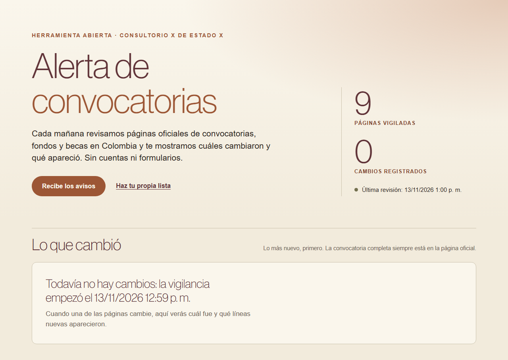

# Alerta de convocatorias · Colombia

[Español](#español) · [English](#english)

## Español

Una herramienta gratis y abierta que revisa cada mañana páginas oficiales de convocatorias, fondos y becas en Colombia, y avisa cuáles cambiaron y qué apareció. Es para equipos de cooperación, ONG, fundaciones, universidades y proyectos que no quieren abrir diez páginas cada semana.

**Ábrela aquí:** https://estado-x.github.io/alerta-convocatorias-colombia/

### Qué hace

- Revisa cada mañana las páginas de `fuentes.txt`: hoy, MinCiencias, MinTIC, APC-Colombia (fondos de cooperación y comisiones mixtas sur-sur), ICETEX (becas en el exterior), Fondo Acción, Fondo Emprender, el Fondo Multidonante de la ONU para la Paz y la Fundación Bolívar Davivienda.
- Muestra cuándo cambió cada página y qué líneas nuevas aparecieron.
- Avisa de tres formas, sin cuentas ni formularios: en la página, por RSS (`data/feed.xml`) y con un aviso en GitHub que llega por correo a quien siga el repo.

### Cómo funciona

1. Un flujo de GitHub Actions corre `scripts/revisar.py` cada mañana (6:00 a. m., hora de Colombia).
2. El script descarga cada página, saca el texto visible línea por línea y lo compara con el de la revisión anterior (`data/textos/`).
3. Si aparecieron o desaparecieron líneas, lo anota en `data/cambios.json`, actualiza `data/estado.json` y el RSS, y abre un aviso (issue) en el repo.
4. Si una página no responde, las demás siguen y esa conserva su última revisión. Cada corrida queda en `data/corrida.json`.

Solo usa la biblioteca estándar de Python: no hay servidor, base de datos ni claves.

### Úsala o adáptala: haz tu propia lista

1. En este repo, pulsa **Use this template** para crear tu copia (gratis, con una cuenta de GitHub).
2. Abre `fuentes.txt` y escribe tus páginas, una por línea: `Nombre | dirección`. Si una página cambia mucho por cosas que no te importan, agrega palabras al final (`Nombre | dirección | beca, convocatoria`) y solo se comparan las líneas que las tengan.
3. En la pestaña **Actions**, activa los flujos. Para prender la revisión diaria, en `.github/workflows/revisar.yml` quita `# ` al inicio de las dos líneas de `schedule`. Con **Run workflow** puedes correrla a mano.
4. Pulsa **Watch → Custom → Issues** para recibir un correo cada vez que una página cambie. Si no quieres avisos en GitHub, cambia `AVISOS_GITHUB: "si"` por `"no"` en el flujo.
5. Para ver tu página, activa GitHub Pages (Settings → Pages → rama `main`, carpeta raíz).

Para probar en tu computador: `python scripts/revisar.py` (Python 3.10 o más reciente).

### Límites

- No lee ni resume las convocatorias, no dice si una encaja con tu proyecto y no postula por ti. Solo avisa que una página cambió: la convocatoria completa siempre está en la página oficial.
- No sirve para páginas que piden iniciar sesión, que cargan todo con JavaScript o que bloquean a los robots.
- Un cambio de diseño de una página puede aparecer como cambio aunque no haya convocatorias nuevas.
- Las convocatorias y los datos son de cada entidad.

### Crédito

- Inspirada en [changedetection.io](https://github.com/dgtlmoon/changedetection.io), de dgtlmoon (licencia Apache-2.0). La escribimos desde cero, más liviana y sin servidor; no reutiliza su código.
- Páginas vigiladas: MinCiencias, MinTIC, APC-Colombia, ICETEX, Fondo Acción, Fondo Emprender (SENA), Fondo Multidonante de las Naciones Unidas para el Sostenimiento de la Paz y Fundación Bolívar Davivienda.

### Hecho por Estado X

Licencia MIT. Esta alerta es una muestra de lo que montamos en Consultorio X de Estado X para el ciclo completo de una convocatoria. Para hablar de tu caso, escríbele a Juan Camilo Pérez Cuervo en LinkedIn: https://www.linkedin.com/in/juanperezcuervo/

## English

A free, open tool that checks official Colombian pages for funding calls, grants and scholarships every morning, and tells you which ones changed and what appeared. Built for cooperation teams, NGOs, foundations, universities and projects.

**Open it here:** https://estado-x.github.io/alerta-convocatorias-colombia/

- **What it does:** checks the pages in `fuentes.txt` every morning (today: MinCiencias, MinTIC, APC-Colombia, ICETEX, Fondo Acción, Fondo Emprender, the UN Multi-Partner Trust Fund for Sustaining Peace and Fundación Bolívar Davivienda), shows when each one changed and which new lines appeared, and alerts you on the page, by RSS (`data/feed.xml`) and with a GitHub issue that reaches anyone watching the repo by email.
- **How it works:** a GitHub Actions workflow runs `scripts/revisar.py` (Python standard library only), which extracts each page's visible text, compares it with the previous run and records the differences. No server, database or API keys.
- **Make your own list:** click **Use this template**, edit `fuentes.txt` (`Name | URL`, one per line), enable Actions and uncomment the two `schedule` lines in `.github/workflows/revisar.yml`, then **Watch → Custom → Issues** to get emails.
- **Limits:** it doesn't read or summarize calls, judge eligibility or apply for you; it only detects that a page changed. It can't watch pages behind a login, built entirely with JavaScript or that block bots. A redesign can show up as a change.
- **Credit:** inspired by [changedetection.io](https://github.com/dgtlmoon/changedetection.io) by dgtlmoon (Apache-2.0), rewritten from scratch without a server. Calls and data belong to each organization.

Made by Estado X · MIT license.
